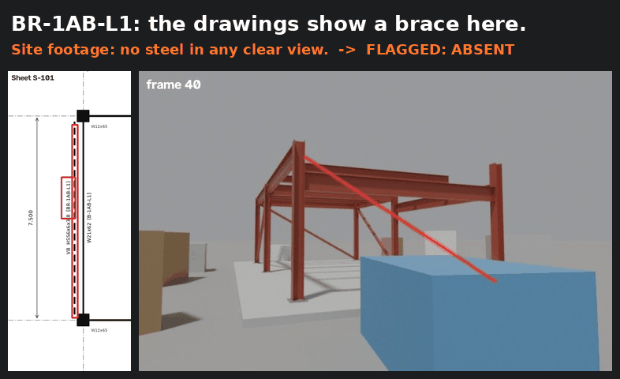
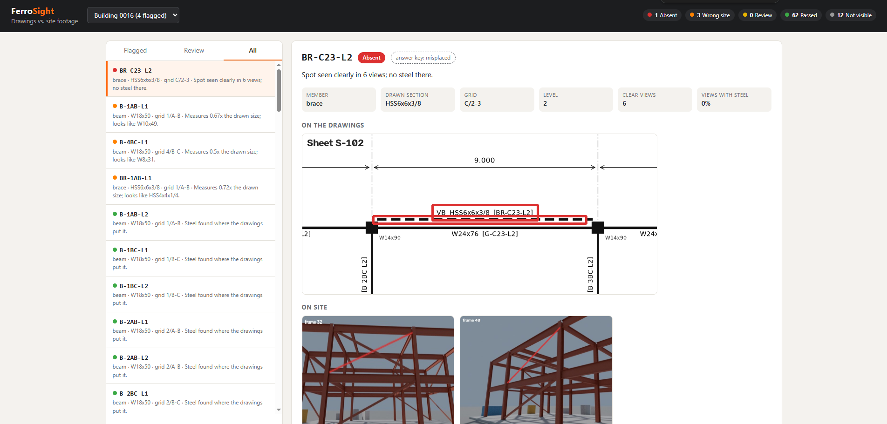
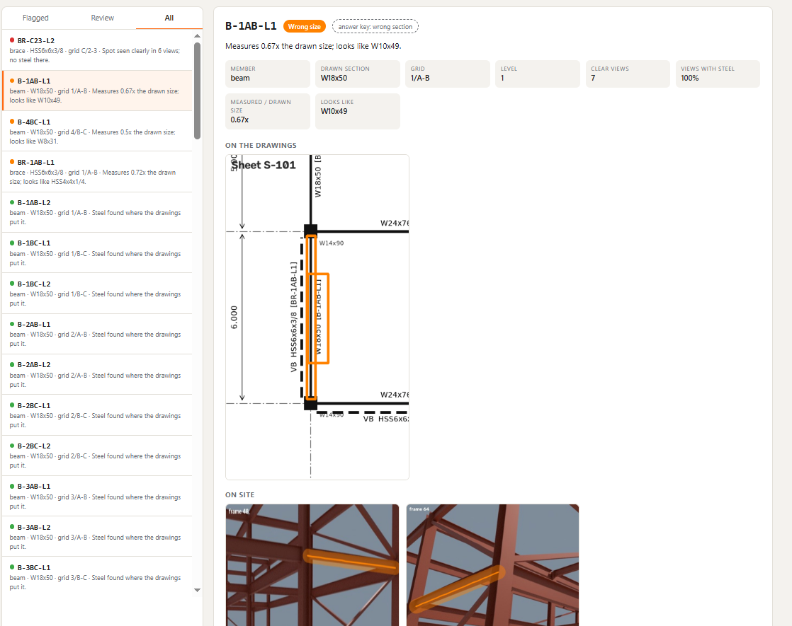
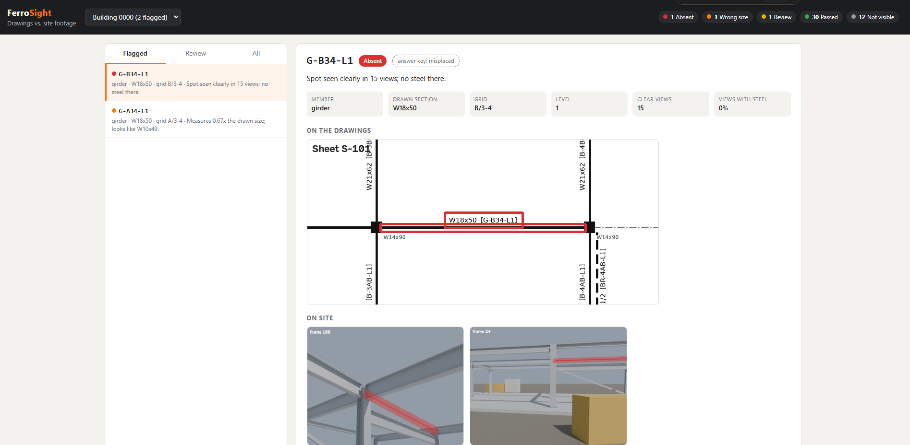
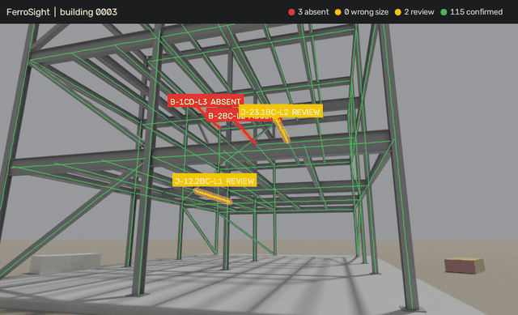
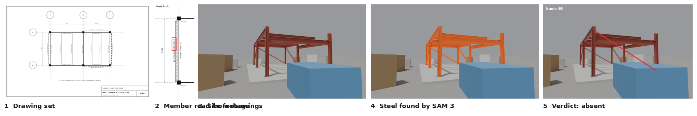
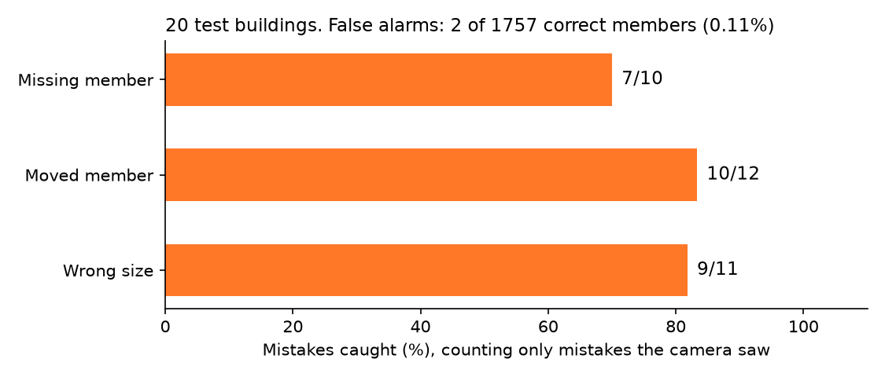

<div align="center">

# FerroSight

**Checks a steel building against its drawings, using only the drawings and site video.**

It reads the structural drawings, finds the steel in the footage, and reports every member that is
missing, moved, or the wrong size, with the drawing and the video frames as evidence.



</div>

## What it does

**Missing or moved member.** The drawings put a brace at C/2-3. The camera saw that spot clearly in
6 views and found no steel there.



**Wrong size.** The drawings call for a W18x50 beam. On site it measures 0.67x that depth and looks
like a W10x49.



**Moved member, seen from 15 views.** Members the camera never saw clearly are reported as
"not visible", and unclear ones go to a person for review. Nothing is guessed.



### Inspection replay

The site walkthrough with FerroSight's verdicts painted on. Confirmed members are thin green lines;
flagged members are labelled.



## How it works



1. **Read the drawings.** Sheet images only, as if scanned. Linework is extracted (columns, beams,
   dashed bracing, diagonals) and erased, so the text left behind can be read by OCR. Each sheet is
   interpreted in its own coordinates (gridlines and dimension strings on plans, level annotations
   on elevations), then the sheets are merged into one 3D model of every member, cross-checked
   against the member schedule.
2. **Find the steel.** SAM 3 segments steel in the site frames from a text prompt.
3. **Match.** Every member from the drawings is projected into every frame using the camera pose.
   SAM 3 masks have no depth, so steel at a pixel could belong to anything along that ray. A member
   is only judged on pixels where no other drawn member appears, in front or behind.
4. **Verify.** Members that need a decision are cropped, enlarged up to 4x, and segmented again
   at full detail. That settles uncertain presence, and gives a thickness measurement that is
   compared with how each catalogue section would look from that exact camera position.
5. **Report.** A web viewer shows each finding with its drawing crop and evidence frames.

## Results

20 synthetic buildings, 1,790 members, 33 planted mistakes the camera could see. The answer key
comes from the generator, so every number below is measured, not eyeballed.



| Stage | Result |
| --- | --- |
| Reading the drawings (clean) | 100% of members found, 100% correct sizes and marks, 1.0 cm mean position error |
| Reading the drawings (scan damage: blur, noise, fading, skew) | 100% of members found, 100% correct sizes |
| Finding steel in footage (SAM 3, no training) | 90.0% overlap with the true steel; 95.9% precision, 93.6% recall |
| Mistakes caught | 26 of 33 (79%): missing 7/10, moved 10/12, wrong size 9/11 |
| False alarms | 2 of 1,757 correct members (0.11%); 17 sent to review |
| Size check, on buildings it was not tuned on | 7 of 7 wrong sizes caught, 0 of 505 correct members flagged |

The size threshold was learned on buildings 0-9 and tested on buildings 10-19.

## Why synthetic data

No public dataset pairs structural drawings with site footage and labelled construction mistakes.
So FerroSight generates its own: a parametric steel frame is designed, drawn (plans, elevations,
schedule), "built" with known mistakes, and filmed in Blender. The renderer also records exactly
which member is at every pixel and whether each mistake was actually visible to the camera, so
"I could not see it" can be scored as a correct answer.

## Run it

```bash
pip install -r requirements.txt
pip install torch torchvision transformers accelerate fastapi uvicorn httpx   # perception, verifier, app
python -m pytest -q

# 1. data: designs, drawings, defects (add --render for footage; needs Blender 4.x)
python -m ferrosight.datagen.generate --out data/synth --n 20 --render

# 2. read the drawings, and score against the answer key (--damage light|heavy for scan damage)
python -m ferrosight.parser.evaluate data/synth

# 3. find steel with SAM 3 (gated model: request access on Hugging Face first)
python -m ferrosight.perception.segment data/synth/scene_00{00..19} --prompts "steel beam" "steel column"
python -m ferrosight.perception.evaluate data/synth

# 4-5. match and verify
python -m ferrosight.matching.match data/synth --evaluate
python -m ferrosight.verify.verify data/synth --evaluate

# viewer
python -m ferrosight.app.server --data data/synth --port 8050
```

## Repository

| Folder | What is in it |
| --- | --- |
| `ferrosight/datagen` | building generator, drawing renderer, defect injection, Blender walkthroughs, labels |
| `ferrosight/parser` | drawing parser: linework, OCR, sheet interpretation, cross-sheet merging |
| `ferrosight/perception` | SAM 3 steel segmentation and its scoring |
| `ferrosight/matching` | depth-aware matching of drawn members to footage |
| `ferrosight/verify` | close-up re-segmentation, presence and size checks |
| `ferrosight/app` | the inspection viewer |

## Limits, honestly

- Everything so far is synthetic. Real footage has real lighting, clutter and motion blur.
- Camera poses are given. On a real site they would come from reconstructing the video.
- The drawing parser is built for this drawing set's conventions. On heavily damaged scans it
  stops rather than guess.
- "Thicker than drawn" is unreliable (outlines spill onto neighbouring steel), so those go to
  review instead of being flagged.

## Next

- Real footage, with camera poses recovered from the video itself
- Vision-language models on the same benchmark: do they understand engineering drawings?
- Active viewing: an agent that decides where to film next to resolve "not visible" members
- A free live demo of the viewer on GitHub Pages
